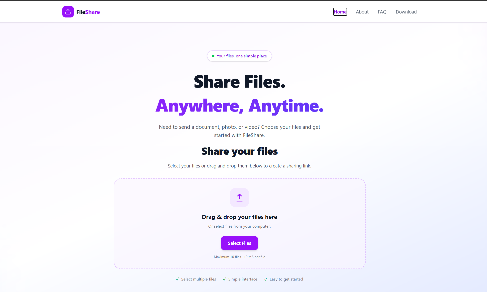

# 📁 FileShare — Share Files Anywhere, Anytime

FileShare is a responsive web application that allows users to upload, share, and download files using PINs, shareable links, and QR codes.

## ✨ Features

- 📤 **Multiple File Uploads** — Upload multiple files at once.
- 🖱️ **Drag and Drop** — Select files or drag them into the upload area.
- 🔢 **PIN-Based Sharing** — Share files using a unique six-character PIN.
- 📱 **QR Code Sharing** — Scan a QR code to access shared files.
- 🔗 **Shareable Links** — Share files with other users through links.
- ⬇️ **File Downloads** — Download shared files to your device.
- ☁️ **Cloud Storage** — Store uploaded files using Cloudinary.
- 📱 **Responsive Design** — Designed for desktop, tablet, and mobile screens.

## 🛠️ Technologies Used

**Frontend**
- React.js
- Tailwind CSS
- JavaScript
- React Router

**Backend**
- Node.js
- Express.js
- Multer

**Cloud Storage**
- Cloudinary

## 📸 Application Preview

### Home Page



## ⚙️ Getting Started

### Prerequisites

- [Node.js](https://nodejs.org/)
- npm
- A [Cloudinary](https://cloudinary.com/) account

### 1. Clone the Repository

```bash
git clone https://github.com/MANISHPARAB12/FileShare.git
cd FileShare
```

### 2. Set Up the Frontend

Open a terminal in the project directory and run:

```bash
cd frontend
npm install
npm run dev
```

Open the local URL displayed in your terminal.

### 3. Set Up the Backend

Open a second terminal in the project directory and run:

```bash
cd backend
npm install
```

Create a `.env` file inside the `backend` directory:

```env
CLOUDINARY_CLOUD_NAME=your_cloud_name
CLOUDINARY_API_KEY=your_api_key
CLOUDINARY_API_SECRET=your_api_secret
PORT=5000
```

Start the backend using the command configured in `backend/package.json`. For example:

```bash
npm start
```

**Note:** Configure the frontend API URL to point to the correct backend address. Never upload your `.env` file or secret credentials to GitHub.

## 📂 Project Structure

```text
FileShare/
├── frontend/
│   ├── src/
│   │   ├── Components/
│   │   │   ├── Navbar.jsx
│   │   │   ├── Home.jsx
│   │   │   ├── Upload.jsx
│   │   │   ├── Download.jsx
│   │   │   ├── About.jsx
│   │   │   └── FAQ.jsx
│   │   ├── App.jsx
│   │   └── main.jsx
│   └── package.json
├── backend/
│   ├── controllers/
│   ├── routes/
│   ├── middleware/
│   ├── services/
│   ├── utils/
│   ├── server.js
│   └── package.json
├── screenshots/
│   └── homepage.png
└── README.md
```

## 🔐 Security

- Store API keys and credentials in environment variables.
- Never commit `.env` files to GitHub.
- Share PINs and links only with intended recipients.
- Validate uploaded files and configure appropriate access controls before public deployment.

## 👨‍💻 Authors

This project was collaboratively developed by:

### Shivam Kesharwani

- **GitHub:** [shivamkesharwani2931](https://github.com/shivamkesharwani2931)
- **LinkedIn:** [Shivam Kesharwani](https://www.linkedin.com/in/shivam-kesharwani-sk/)

### Manish Parab

- **GitHub:** [MANISHPARAB12](https://github.com/MANISHPARAB12)
- **LinkedIn:** [Manish Parab](https://www.linkedin.com/in/manish-parab-16a18a311/)

---

⭐ If you find this project useful, consider giving the repository a star!


CLOUDINARY_API_KEY 549422148137159

CLOUDINARY_API_SECRET VkllFrSexdGbSW5Ow1KP1_buJ48

CLOUDINARY_CLOUD_NAME zhpthsqs

NODE_ENV  development